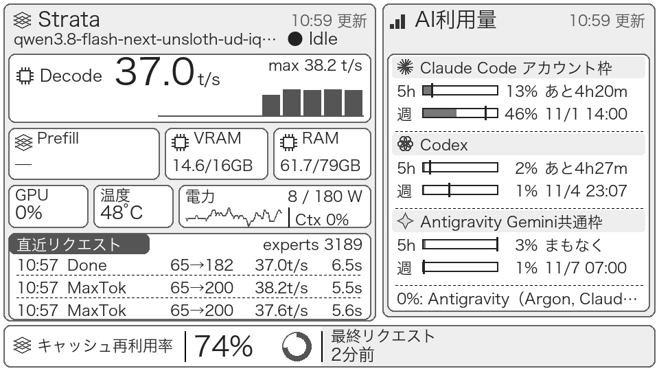

# paper-hub

Strataのローカル推論メトリクスとxangiのAI利用量を、M5Stack PaperDIYへ表示するダッシュボードです。Pythonサーバが960×540・16階調グレーのPNGを生成し、PaperDIYがWi-Fiで取得・描画してdeep sleepします。



[Strata詳細](docs/images/sample-strata.png) / [AI利用量詳細](docs/images/sample-usage.png)（同じfixtureから生成）

```text
Strata /metrics ─┐
                ├─ paper-hub（Raspberry Pi）─ /paper.png ─ PaperDIY
xangi /api/usage ┘
```

## できること

- Strata・xangiを独立して取得し、前回値の保持、1回のリトライ、取得失敗・オフラインを表示。
- カード形式で使用率とペース、直近リクエスト、decode棒グラフ、電力スパークライン、再利用率リングを描画。
- SQLite履歴と最後の有効Prefillを保存し、PNGをメモリにキャッシュ。
- PaperDIYでPSRAMへ受信・検証。Bでダッシュボード→Strata詳細→AI利用量詳細を巡回、A・タイマーで現在の画面を更新、A+Bでダッシュボードへ戻す。

開発はmacOS、サーバ実行はPython 3.11以上のRaspberry Pi OS 64bitを想定しています。ライセンスは[MIT](LICENSE)です。

## 必要なもの

- M5Stack PaperDIYとUSBデータケーブル。
- Raspberry Pi（実機確認はRaspberry Pi 5）、またはLinux/macOSでPython 3.11以上を実行できる環境。
- [Strata](https://github.com/Niko1221/Strata) の `/metrics` を利用します。認証を有効にしている場合は `STRATA_API_KEY` を設定します。
- [xangi](https://github.com/karaage0703/xangi): `/api/usage` を利用。
- 日本語フォントとWi-Fiネットワーク。

対応確認したバージョンは、Strata **0.1.54**（fixtureの `engine.version`）、xangi **v0.61.1**です。ファームウェアのボード・ライブラリの組み合わせは[専用手順](docs/firmware.md)に記載しています。

3画面対応は[サーバを先にデプロイ](docs/deployment.md)してからファームウェアを書き込んでください。

## 最初に動かす

```sh
python3 -m venv .venv
.venv/bin/python -m pip install -e '.[test]'
cp .env.sample .env
```

ローカルの `.env` を編集し、まず日本語フォントの `FONT_PATH` を設定します。設定例に実環境の値は同梱していません。

```sh
.venv/bin/python -m paperhub.render \
  --strata tests/fixtures/strata_monitor.json \
  --usage tests/fixtures/xangi_usage.json \
  --out out/paper.png --now 1793411985
.venv/bin/python -m pytest -q
```

PNG生成はネットワークを使いません。テストも依存導入後はネットワーク不要です。C++コンパイラがない場合、ファームウェアのホストテストだけスキップします。

実データで動かす場合は取得元URLを `.env` に設定し、次で起動します。

```sh
.venv/bin/python -m paperhub.server
```

## ドキュメント

| 内容 | 参照先 |
|---|---|
| 現行仕様と公開前提 | [SPEC.md](SPEC.md) |
| 設定項目・秘密ファイル | [設定](docs/configuration.md) |
| fixture描画・API・取得失敗・SQLite | [サーバ運用](docs/server.md) |
| Pi常駐化・Macからの更新・ufw | [導入とデプロイ](docs/deployment.md) |
| Arduino CLI・秘密設定・USB書き込み・ログ | [ファームウェア](docs/firmware.md) |
| 計算関数と戻り値 | [計算API](docs/api.md) |
| 丸め・省略・フォールバックなどの判断 | [設計メモ](docs/design.md) |
| 公開前の点検方法と今回の結果 | [公開・プライバシー確認](docs/privacy.md) |
| 開発と変更の提出 | [CONTRIBUTING.md](CONTRIBUTING.md) |
| セキュリティと報告 | [SECURITY.md](SECURITY.md) |
| 変更履歴 | [CHANGELOG.md](CHANGELOG.md) |

## GitHubへ公開する前に

```sh
.venv/bin/python scripts/check_public.py --history
```

`.env`、`secrets.h`、履歴DB、ログ、ビルド成果物を含めない構成です。診断ログには取得先やレスポンスの一部が入るため、Issueに貼る前に匿名化してください。点検スクリプトは既知のパターンを調べるもので、任意の個人情報の完全検出は保証しません。

## 確認状況

- Python・C++ホストテスト、およびM5PaperDIY向けビルドを確認済み。
- Raspberry Pi 5での常駐、Macからのdeployを確認済み。
- PaperDIYへのUSB書き込み、実機でのダッシュボード表示、電池残量表示を確認済み。
- カード形式の新レイアウトはfixture画像・自動テスト・PaperDIY実機で表示を確認済み。
- 3画面対応はPython・C++ホストテスト、fixture画像、PaperDIY向けビルドを確認済み。ボタンBの巡回・同時押し・詳細画面の維持・失敗復帰は[実機チェックリスト](docs/firmware.md)で確認してください。
- 未検証: 上記の3画面切替の実機動作、電池持続時間の長期計測。
